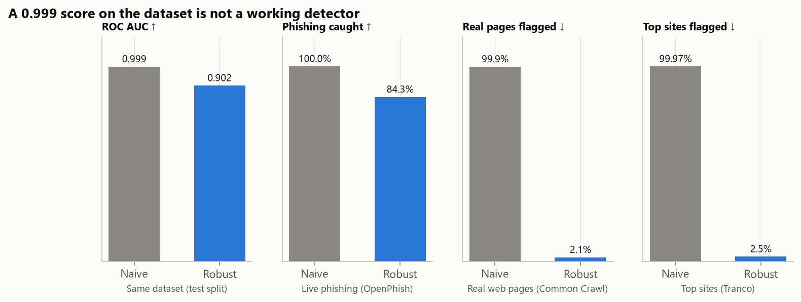
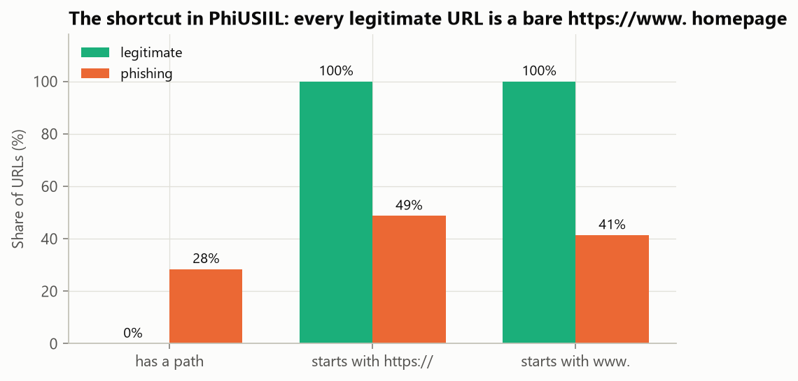
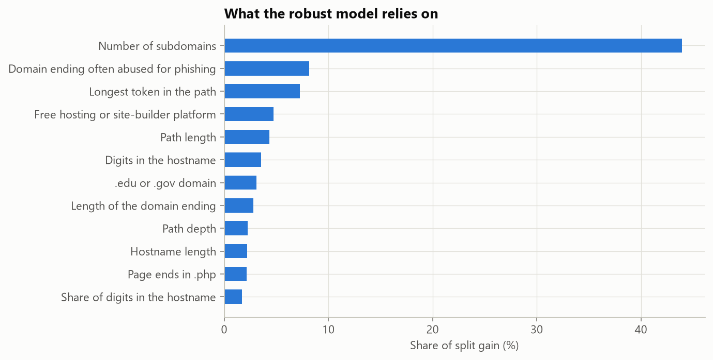

# Phishing URL detector, tested on sources it never saw

**Live demo: [kmuhwati.github.io/phishing-url-detector](https://kmuhwati.github.io/phishing-url-detector/)**

   

Paste a link into the demo and it returns a phishing score and the reasons behind it. The model is a gradient-boosted tree ensemble that reads only the text of the URL, so it runs in the browser with no server, and nothing typed into the page is sent anywhere.

The more interesting part is the evaluation. PhiUSIIL (UCI, 2024) is the public phishing URL dataset most tutorials use, and models trained on it report accuracy above 99.9%. That number comes from a shortcut in the data: **every one of its 134,850 legitimate URLs is a bare `https://www.` homepage**, while phishing URLs often lack `https`, lack `www.` or have a path. A model trained the usual way learns that rule and then flags 99.9% of real web pages as phishing. This project shows the failure, builds a model that cannot use the shortcut, and tests it on three outside sources.



## Results at a glance

The alert threshold is set on a validation split so that 1% of legitimate URLs are flagged. The same threshold is then used on every test set.

| Test set | What it measures | Naive model | **Robust model** |
|---|---|---|---|
| PhiUSIIL test split | ROC AUC on the training dataset | 0.999 (random split) | **0.902** (split by site) |
| OpenPhish live feed, 300 URLs downloaded 15 Nov 2026 | phishing caught | 100% | **84.3%** (95% CI 79.8–88.0%) |
| Common Crawl pages from unseen sites, 9,668 URLs | real pages wrongly flagged | 99.9% | **2.1%** |
| Tranco top sites not seen in training, 10,000 | popular homepages wrongly flagged | 99.97% | **2.5%** |

The naive model looks perfect on its own test split and is useless on the open web. The robust model scores lower on PhiUSIIL but holds up on data it never saw. On the live feed it caught 253 of 300 phishing links.

## What the evaluation shows

1. **The dataset has a shortcut, and a model finds it at once.** In PhiUSIIL, legitimate URLs are 100% `https`, 100% `www.` and 0% have a path. Phishing URLs are 49% `https`, 41% `www.` and 28% have a path. The naive model, given the URL as written, puts 90% of its gain on two features: "starts with `https://`" and "starts with `www.`".

   

2. **A random split hides the problem.** Splitting rows at random puts URLs from the same site in both train and test, and the shortcut is just as present in the test rows. The robust model is instead split by registered domain, so no site appears on both sides. Its AUC on PhiUSIIL drops to 0.902 and its recall at 1% false positives is 65%. That is a more honest estimate of how it would do on new sites.

3. **Removing the shortcut means changing the input, not the model.** The robust model never sees the scheme or a leading `www.`: they are stripped before any feature is computed. It also trains on 35,002 real page URLs from Common Crawl (with paths, queries and subdomains), so "has a path" no longer means "phishing". What it learns instead is closer to what security analysts look for: many subdomains (44% of the gain), domain endings often abused for phishing, long random tokens in the path, free hosting platforms and digits in the hostname.

   

4. **False positives roughly double outside the training data.** The threshold targets 1% false positives on validation data, and the model reaches 1.05% on the in-dataset test. On unseen Common Crawl pages and Tranco homepages the rate is 2.1% and 2.5%. That is the gap a deployment would see, and it is why the demo describes its score as a second opinion.

## The demo

[Open it here.](https://kmuhwati.github.io/phishing-url-detector/) Type or paste a URL, or try one of the examples. The result is laid out like a payment-risk review:

* a risk score from 0 to 99 on a segmented scale, with the alert level marked (the 1%-false-positive threshold);
* the address split the way the model reads it: subdomains, the registered domain, the path and query, with the scheme and `www.` struck through because the model ignores them;
* the seven factors that moved the score most, drawn as bars to the left (lowers risk) or right (raises risk) of zero. These are per-tree path contributions, which add up exactly to the score;
* the held-out results above, so a visitor can see how far to trust it.

The model is a 568 KB JSON file (136 KB compressed) of 300 trees, evaluated by 30 lines of JavaScript (`web/src/model.js`).

## How the browser and Python stay in step

The features are written once, in JavaScript (`web/src/features.js`). The Python training pipeline does not reimplement them: it calls the same file through Node (`scripts/extract_features.mjs`). The trained LightGBM model is exported as compact trees, and a test (`web/test/model.test.js`) checks that the JavaScript scores match LightGBM's own raw scores to within 1e-5 on 203 held-out URLs. A model that scores one way in a notebook and another way in production is a common bug, and this design rules it out.

## Method

| Step | Detail |
|---|---|
| Training data | PhiUSIIL, 235,795 URLs (100,945 phishing), plus 35,002 Common Crawl page URLs (CC-MAIN-2026-39, 12 of 16 files) as extra legitimate examples |
| Split | Grouped by registered domain: 192,560 train, 24,689 validation, 53,548 test |
| Features | 35 lexical features of the hostname and path; scheme and `www.` removed first |
| Model | LightGBM, 300 trees, 31 leaves, learning rate 0.08 |
| Threshold | 1% false positive rate on the validation split (score 0.703) |
| Held-out tests | OpenPhish community feed on the day of the run; Common Crawl pages from the other 4 files; Tranco top 20,000. Any site seen in training is removed from the legitimate test sets |
| Naive baseline | Same model on the raw URL plus four shortcut features, random 80/20 split |

## Limitations

* The model reads only the URL. It cannot see the page, the certificate or the domain's age, which real filters also use. A phishing page on a clean-looking domain with a short path will get past it.
* 300 live URLs is a small sample, hence the wide confidence interval. The feed is a snapshot of one day.
* Labels for Common Crawl and Tranco are assumed legitimate. A few may not be, which would make the false positive rates slightly too high.
* The brand allowlist and the lists of risky domain endings and free hosts are hand-written. They will need updating as attackers move.
* Attackers can adapt to any public lexical model. This is a demonstration of evaluation practice, not a security product.

## Reproduce

```bash
pip install -r requirements.txt
python scripts/download_data.py                  # PhiUSIIL, Tranco list, OpenPhish feed
python scripts/collect_commoncrawl_urls.py <corpus dir from the LLM data refinery project>
python scripts/run_pipeline.py                   # train, evaluate, export web/public/model.json
pytest -q

cd web
npm ci
npm test                                         # JavaScript matches LightGBM
npm run dev
```

The Common Crawl URLs come from the [LLM data refinery](https://github.com/kmuhwati/llm-pretraining-data-refinery) project. Every push to `main` runs both test suites, builds the site and deploys it to GitHub Pages (`.github/workflows/ci.yml`).

## Structure

```
src/phishdetect/
  data.py        loaders, registered-domain helper, held-out sets
  pipeline.py    features via Node, splits, training, evaluation, export, figures
scripts/         download_data.py, collect_commoncrawl_urls.py, extract_features.mjs, run_pipeline.py
tests/           threshold rule, scoring, Node feature bridge
reports/         metrics.json, RESULTS.md, tables/, figures/
web/             React + Vite app; src/features.js is the single feature implementation
```

## Data

PhiUSIIL Phishing URL Dataset (Prasad and Chandra, UCI, 2024), CC BY 4.0. Common Crawl CC-MAIN-2026-39. OpenPhish community feed. Tranco list (Le Pochat et al., 2019). Raw data is downloaded by the scripts and not stored in this repository, and the live phishing URLs are not redistributed.
